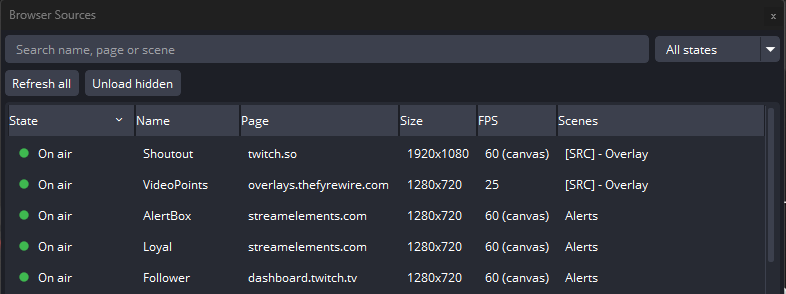

# My OBS Plugins

Small, focused plugins that make streaming with OBS Studio easier.

 

---

## Plugins

| # | Plugin | What it does | Version | Status |
| :-: | :--- | :--- | :-: | :-: |
| 1 | [Browser Source Manager](#1-browser-source-manager) | See and control every browser source from one dock | 1.0.1 | Done |

**Done**: released &nbsp;·&nbsp; **Pending**: in progress &nbsp;·&nbsp; **Not started**: planned

---

## 1. Browser Source Manager

`v1.0.1` &nbsp;·&nbsp; Added 31 Oct 2026 &nbsp;·&nbsp; [Repository](https://github.com/Moh-01/BrowserSourceManager) &nbsp;·&nbsp; [Download](https://github.com/Moh-01/BrowserSourceManager/releases/latest)

A dock that lists every browser source and shows which ones are on air and which are still running while hidden, so you can refresh or unload them without opening each one.

- Every browser source with its website, size, FPS and scenes
- Live state: on air, preview, hidden but running, unloaded
- Refresh all pages, or unload every hidden one, in one click
- Search, filter and sort

---
